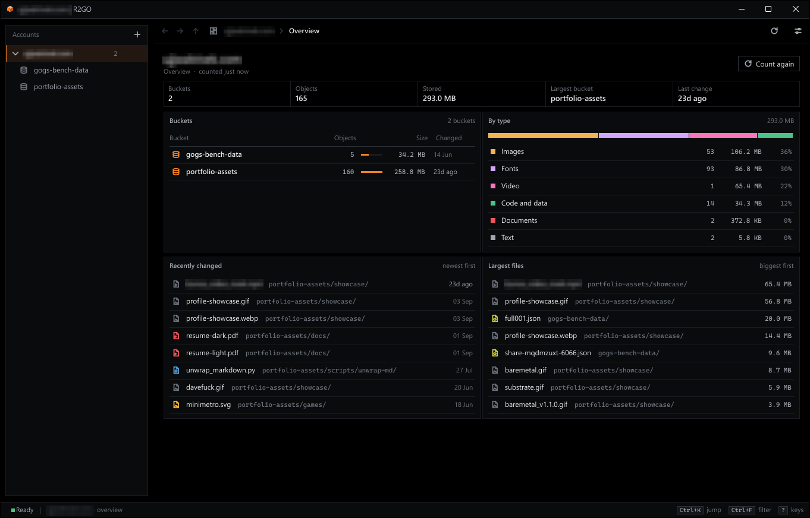
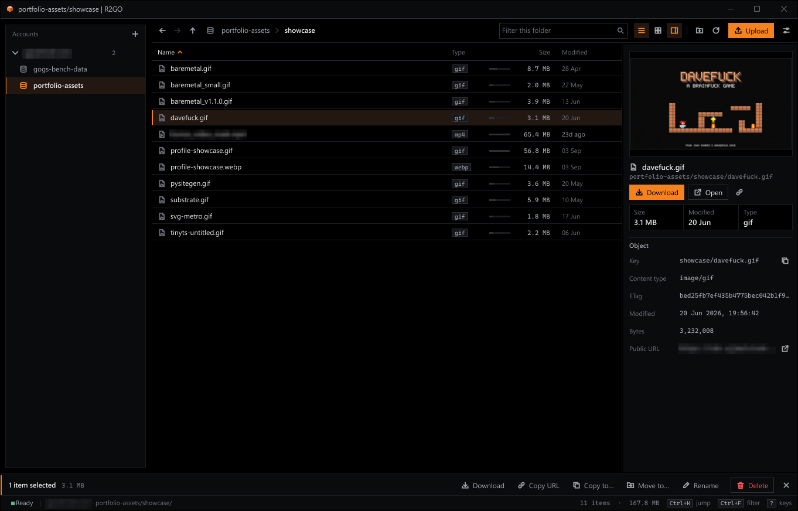
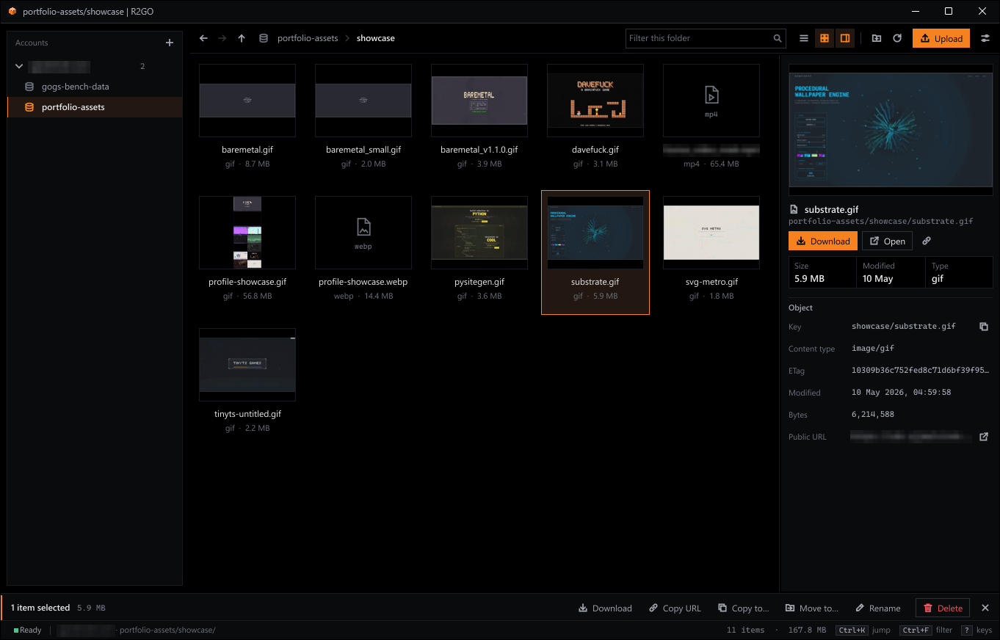
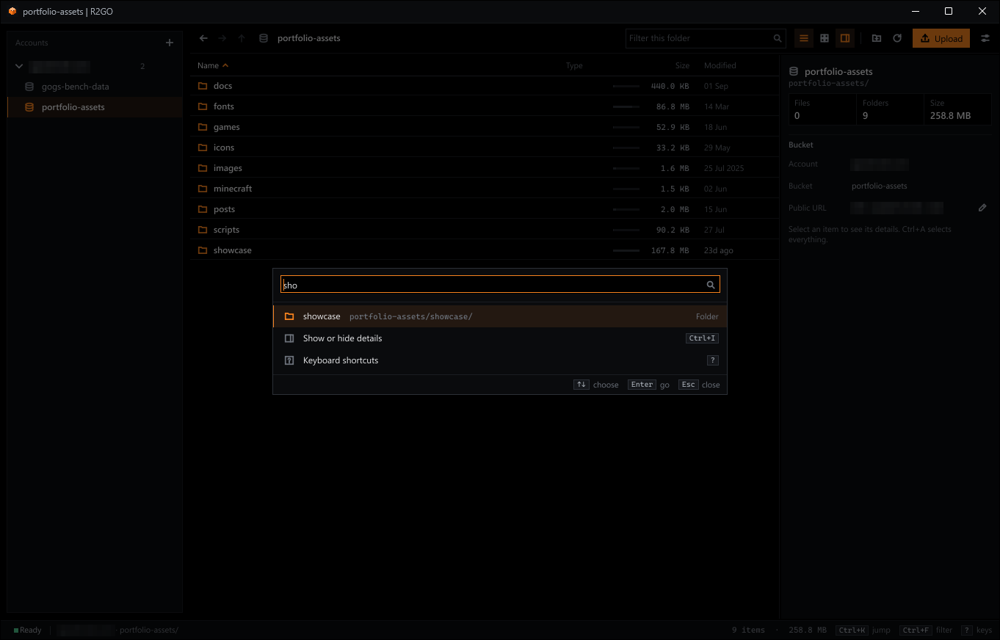
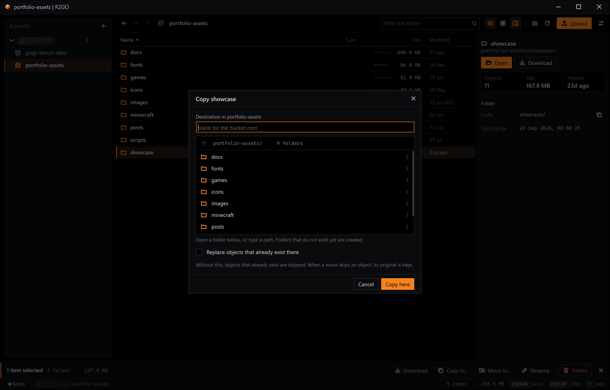
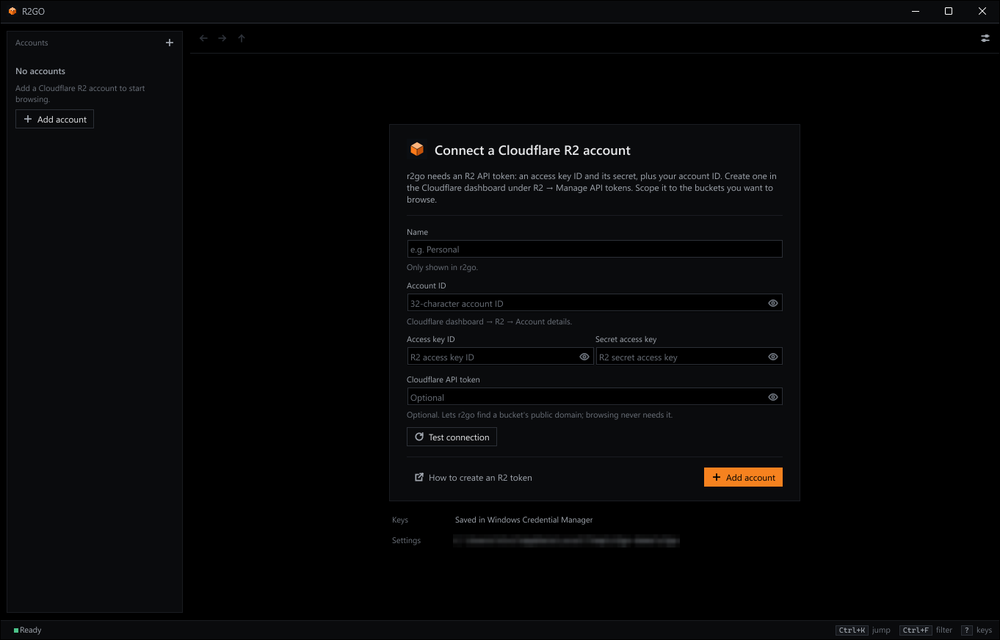

# R2GO

A fast, keyboard-friendly desktop explorer for **Cloudflare R2**, written in Go.



Every account opens on an overview: what's stored where, what kind of files they are, and what changed recently.

## Browse



Sortable list with size bars and relative ages, and a details panel with a preview, content type, ETag, metadata and the public URL.

<table>
  <tr>
    <td width="50%"></td>
    <td width="50%"></td>
  </tr>
  <tr>
    <td><b>Grid view.</b> Image previews (PNG, JPEG, GIF, WebP, BMP, SVG, ICO), cached on disk by version. Other files get colour-coded format badges.</td>
    <td><b>Quick jump.</b> <code>Ctrl+K</code> goes to any bucket, folder or action. <code>Ctrl+L</code> takes a typed path.</td>
  </tr>
  <tr>
    <td width="50%"></td>
    <td width="50%"></td>
  </tr>
  <tr>
    <td><b>Copy and move.</b> Browse to a destination or type one. Choose to skip or replace existing objects.</td>
    <td><b>First run.</b> Add an account inline. Keys are masked and go to the OS keychain.</td>
  </tr>
</table>

You can also:

- Upload files and folders with native pickers or drag and drop. Large files upload in parts.
- Download with folder structure preserved.
- Run background transfers with speed, time left, cancel and retry.
- Rename, delete and copy/move in batches. Destructive actions always ask first.
- Use several accounts side by side.
- Copy shareable links once a bucket's custom domain or `r2.dev` address is set. R2GO can find it for you with an optional API token.

**Note:** On Linux, file pickers use `zenity` or `kdialog` when installed, and a built-in picker otherwise.

## Install and build

Requirements:

- Go **1.25+**
- A C toolchain for Fyne. On Debian/Ubuntu: `sudo apt-get install gcc libgl1-mesa-dev xorg-dev`.

```sh
./scripts/build.ps1        # Windows
```

```sh
./scripts/build.sh         # Linux / macOS
go run ./cmd/r2go          # or run it directly
```

For Development:

```sh
go test ./...
go vet ./...
```

**Note:** Build with `-tags dev` to drive the window from a script for screenshots, the steps are listed in [`internal/ui/devhooks_dev.go`](internal/ui/devhooks_dev.go).

## Project layout

```sh
cmd/r2go/              entry point
internal/app/          bootstrap
internal/cloudflare/   public-domain discovery
internal/config/       accounts, settings, secrets
internal/explorer/     copy, move, delete and rename (tested, UI-free)
internal/model/        object and view models
internal/r2/           R2 S3 client
internal/theme/        design tokens, fonts, icons
internal/transfer/     background transfer queue
internal/ui/           Fyne UI
internal/util/         OS helpers
```

## Add an account

You need an R2 API token: an **account ID**, an **access key ID** and a **secret access key**. Create one in the Cloudflare dashboard under _R2 → Manage API tokens_, scoped to the buckets you want. A **Cloudflare API token** is optional and only used to discover public domains. Settings live in the OS config directory. Keys go to Windows Credential Manager, the macOS Keychain or Secret Service/KWallet.

**Note:** Without a keyring they fall back to a local `secrets.bin` file, which is **not encrypted**. It is protected only by your OS account permissions.

## Keyboard

Press `?` in the app for the full list. The essentials:

| Keys                                    | Does                                                     |
| --------------------------------------- | -------------------------------------------------------- |
| `Ctrl+K`, `Ctrl+L`, `Ctrl+F`            | Jump anywhere, type a path, filter the folder            |
| `↑` `↓` `Home` `End`, `Shift` to extend | Move and extend the selection; type a name to jump to it |
| `Enter`, `Backspace`, `Alt+←` `Alt+→`   | Open, go up, go back and forward                         |
| `Ctrl+U`, `Ctrl+D`                      | Upload, download                                         |
| `F2`, `Del`, `Ctrl+Shift+N`             | Rename, delete, new folder                               |
| `Ctrl+C` `Ctrl+X` `Ctrl+V`              | Copy, cut and paste within a bucket                      |
| `Ctrl+1`, `Ctrl+2`, `Ctrl+I`            | List or grid, details panel                              |
| `F5`, `Ctrl+,`                          | Refresh, settings                                        |

## License

MIT. See [LICENSE](LICENSE).
